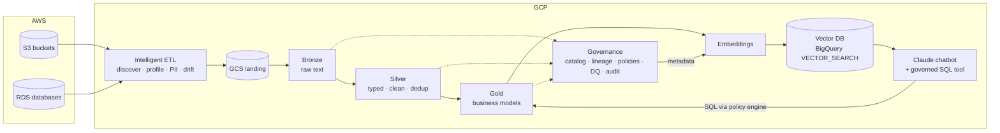

# Enterprise Data Management Suite (EDMS)

**Intelligent ETL + Meta RAG + Data Governance**, combined into one platform with one UI that runs the whole flow end to end.

It moves an organisation's data from **AWS** (S3 buckets and RDS databases) to **Google Cloud**. Raw files land in GCS. BigQuery then builds the **Bronze → Silver → Gold** medallion layers. **Governance** covers the catalog, lineage, classification, role-based masking, data quality, retention and auditing. A **RAG chatbot** (Claude + a vector database) answers questions in plain language, using governed SQL.



## Quick start (local, no cloud account needed)

```bash
pip install -r requirements.txt
```

```bash
streamlit run app/streamlit_app.py
```

Open the **Overview** page and click **▶ Run end-to-end**. If there's no AWS data yet, the suite creates a sample company first. That sample has 3 S3 buckets (CSV, JSON and Parquet files) and 1 RDS database, with messy data on purpose. It then migrates everything, builds all three layers, publishes governance metadata and indexes the RAG store.

To turn on full LLM answers, set an API key before you start the app (without one, the chatbot runs in offline retrieval mode):

```bash
export ANTHROPIC_API_KEY=sk-ant-...
```

Command line:

```bash
python -m scripts.run_pipeline
```

```bash
python -m scripts.run_pipeline --ask "Top 5 customers by lifetime value" --role business_analyst
```

```bash
python -m pytest -q
```

In `local` mode, local stand-ins replace each cloud service. The SQL and the code paths are the same as in production.

| Production (GCP mode) | Local stand-in |
|---|---|
| AWS S3 (boto3) | `data/aws_s3/<bucket>/<prefix>/files` |
| AWS RDS (SQLAlchemy) | SQLite in `data/aws_rds` |
| GCS landing bucket | `data/gcs_landing` |
| BigQuery | DuckDB (`data/warehouse.duckdb`) |
| Vertex AI embeddings + BigQuery `VECTOR_SEARCH` | Hashing embedder + NumPy vector store |

## The three modules

### 1. Intelligent ETL (`edms/etl`, `edms/storage`)
* **Auto-discovery**: every prefix in each configured S3 bucket and every table in each RDS database becomes a dataset. You don't write code for each table.
* **Landing**: raw objects are copied byte-for-byte into GCS (`raw/<system>/<container>/ingest_date=.../`).
* **Bronze**: all columns are kept as text, with `_source_uri`, `_ingested_at` and `_batch_id` added. Column names are normalised. **Schema drift** against the previous load is detected and logged.
* **Silver**: a profiler samples each table and works out:
  * the column types, including currency strings like `$1,234.50`
  * the primary key
  * PII (email, phone, SSN, card, DOB, names, salary…)

  It then **generates SQL that runs inside BigQuery** to trim values, normalise nulls, cast types safely and de-duplicate (the latest record wins). Rows with no valid key go to `quarantine__<table>`.
* **Gold**: business models live in `config/gold_models.yaml`. They are dialect-neutral SQL with `{{ ref() }}` and macros.
* **Reconciliation**: row counts are compared from source to Bronze to Silver, including duplicates removed, quarantined rows and type-conversion failures.
* **Data quality**: completeness, uniqueness, validity (no negative amounts, valid email format) and volume checks.

### 2. Meta RAG (`edms/rag`)
* **Indexes metadata *and* data**: table cards from the catalog (columns, classification, lineage, DQ), the business glossary, Gold rows, and Silver tables with a lot of free text (such as support tickets).
* **Governance-aware**: personal data is removed *before* embedding, so the vector DB never holds PII. Retrieval is filtered by the tables the user's role may read.
* **Claude (`claude-opus-5-5`)** answers using the retrieved context and two tools:
  * `run_sql`: a read-only query that goes through the policy engine (access check, masking, audit)
  * `search_knowledge`: extra retrieval when the first context isn't enough

  Answers cite their sources. The UI shows every SQL query and its result. Server-side refusal fallbacks are turned on (`fallbacks="default"`).

### 3. Data Governance (`edms/governance`, `config/policies.yaml`)
* **Catalog**: owner, domain, description, row counts, DQ score, retention and source for every table and column.
* **Classification**: PUBLIC / INTERNAL / CONFIDENTIAL / RESTRICTED. Classifications are found by profiling and **passed downstream through lineage**, so a Gold column built from a sensitive column stays sensitive.
* **Lineage**: AWS object → GCS → Bronze → Silver → Gold, shown as an interactive graph.
* **Access policies**: roles grant layers, domains and a clearance level. Columns above the viewer's clearance are **tokenised** (CONFIDENTIAL, still joinable) or **redacted** (RESTRICTED). Only single `SELECT` statements are allowed.
* **Audit log**: every pipeline run, query (allowed or denied), chat and index build is recorded.
* **Native BigQuery export**: a generated script holds the dataset `GRANT`s, labels, column descriptions, retention, a row-access policy and the policy-tag plan. Download it from the UI.

## UI tour
| Page | What you can do |
|---|---|
| 🏠 Overview | KPIs, architecture diagram, **Run end-to-end**, latest reconciliation |
| ⚙️ Intelligent ETL | Scan the AWS estate, run selected layers with a live log, browse any table (masked for your role), see the inferred profile and generated Silver SQL, reconciliation, run history and schema drift |
| 💬 Meta RAG | Chat with your data, see the sources and SQL behind every answer, rebuild the index |
| 🛡️ Data Governance | Searchable catalog, lineage graph, role access matrix, governed query sandbox, BigQuery policy export, PII inventory, DQ scorecard, audit log |

The **Acting as role** selector in the sidebar applies the policies everywhere. For example, switch to `business_analyst` and ask for top customers: names and emails come back tokenised. Ask the same as `hr_partner` and you'll be denied, because the role is limited to the HR domain.

## Deploying to GCP (Cloud Run)

Run `deploy/deploy.sh` from the repository root in **Cloud Shell**, which is already signed in to your Google account. It enables the APIs, creates a least-privilege service account and builds one image with Cloud Build. It then deploys the UI as a Cloud Run service. API keys are typed at a hidden prompt and stored in Secret Manager, never in files.

**Demo**: the UI with the built-in sample company. It bootstraps itself on start and resets when the instance restarts.

```bash
git clone https://github.com/nafeesnaseer11-arch/enterprise-data-management-suite && cd enterprise-data-management-suite
```

```bash
./deploy/deploy.sh --project YOUR_PROJECT_ID
```

**Production**: real AWS data goes to the GCS landing bucket and BigQuery Bronze/Silver/Gold, with Vertex AI embeddings and BigQuery `VECTOR_SEARCH`. A nightly Cloud Run job runs the pipeline. First edit `aws.s3_buckets` / `aws.rds_databases` in `config/settings.yaml`, then:

```bash
./deploy/deploy.sh --project YOUR_PROJECT_ID --mode gcp
```

```bash
gcloud run jobs execute edms-pipeline --region us-central1 --wait
```

The UI is private by default. Open it through an authenticated proxy (then use Cloud Shell **Web Preview** on port 8080), or redeploy with `--public` if your organisation allows unauthenticated services:

```bash
gcloud run services proxy edms --region us-central1 --port 8080
```

`infra/terraform` is an alternative if you'd rather manage the foundation as code (datasets with retention, landing bucket, Storage Transfer Service jobs for bulk S3 copies, Secret Manager). To enforce the policies natively, run the BigQuery governance script from the Governance page with `bq query`.

## Notes and next steps
* Bronze does full-snapshot loads. For very large tables, add incremental watermarks (for example on `updated_at` or S3 `LastModified`).
* The pipeline copies S3 objects itself, which works for gigabyte-scale estates. For terabyte-scale buckets, let the Storage Transfer Service jobs in Terraform do the copy, and add a GCS-backed source that reads from `gs://<landing>/sts/...`.
* Native column masking needs Data Catalog policy tags and BigQuery data policies. The script prints exactly which columns to tag. Attaching the tags is a one-time admin step.
* Locally, DuckDB allows only one writer process. Stop the Streamlit app before you run the CLI against the same `data/warehouse.duckdb`.
